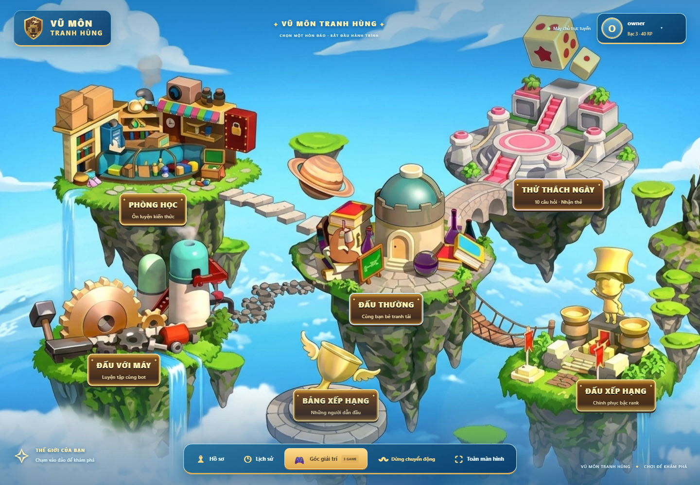
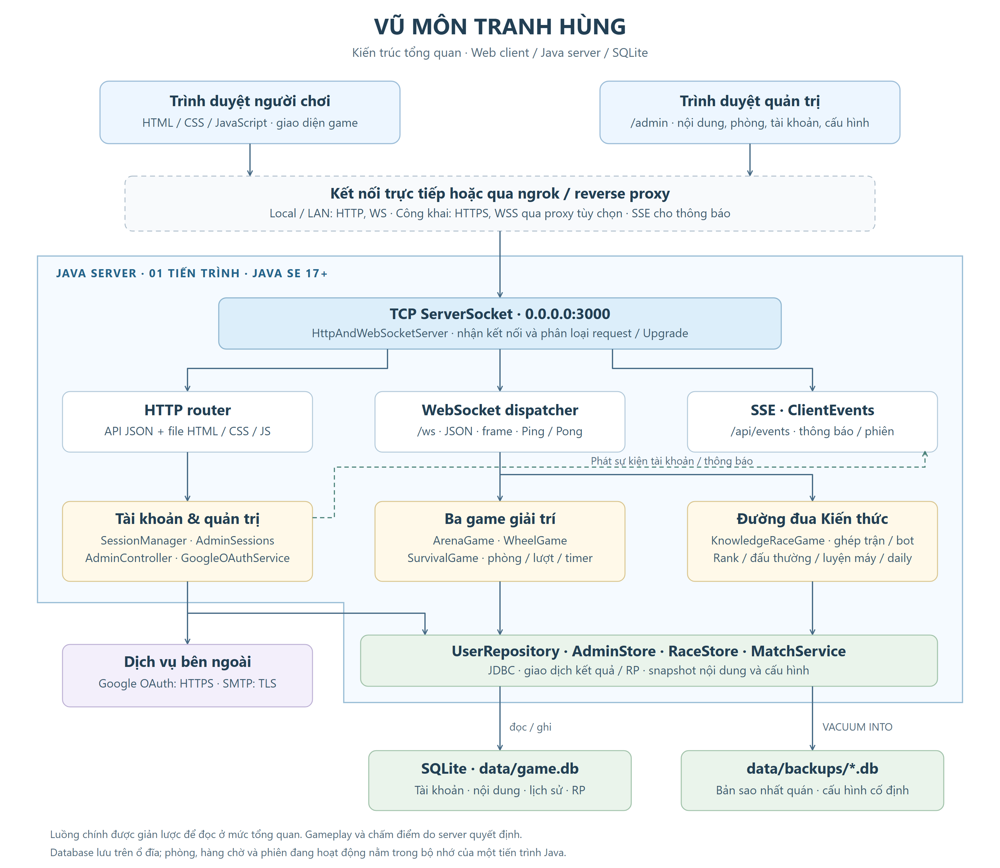
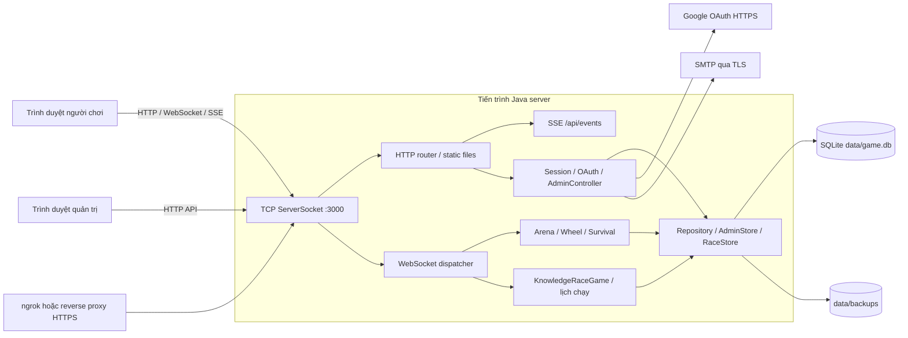
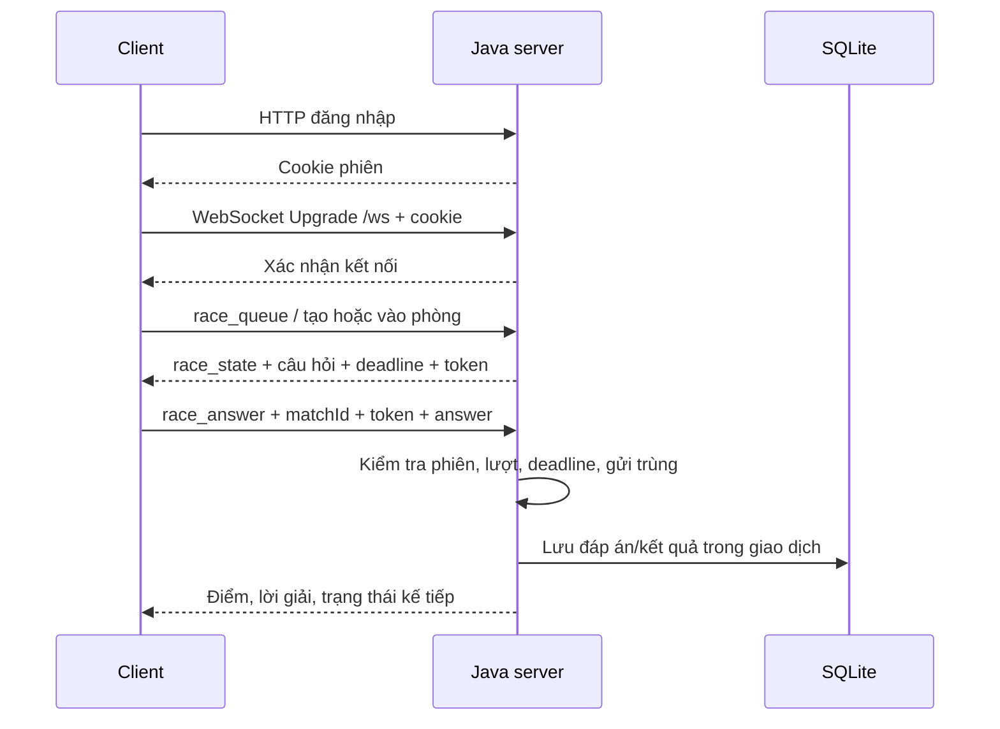
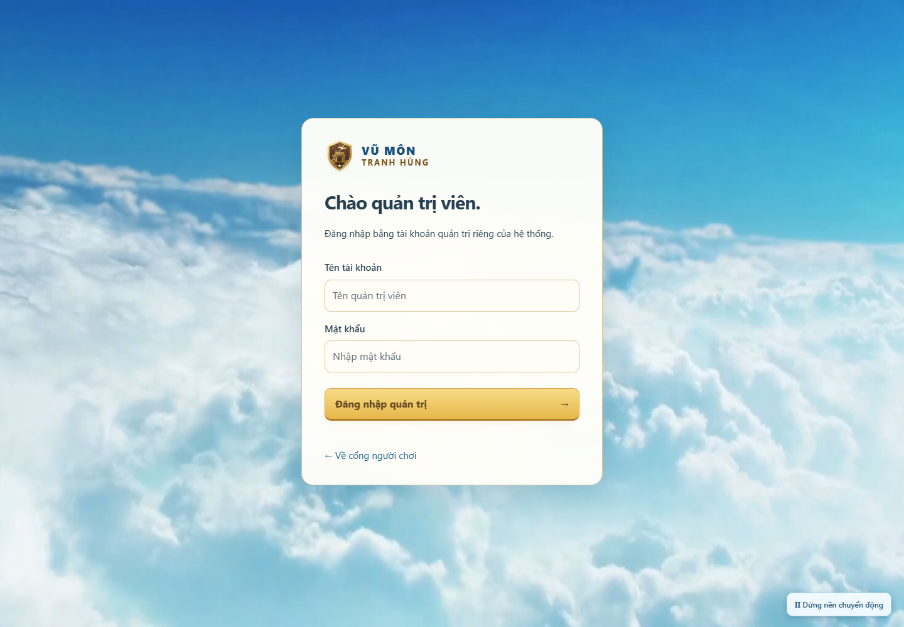
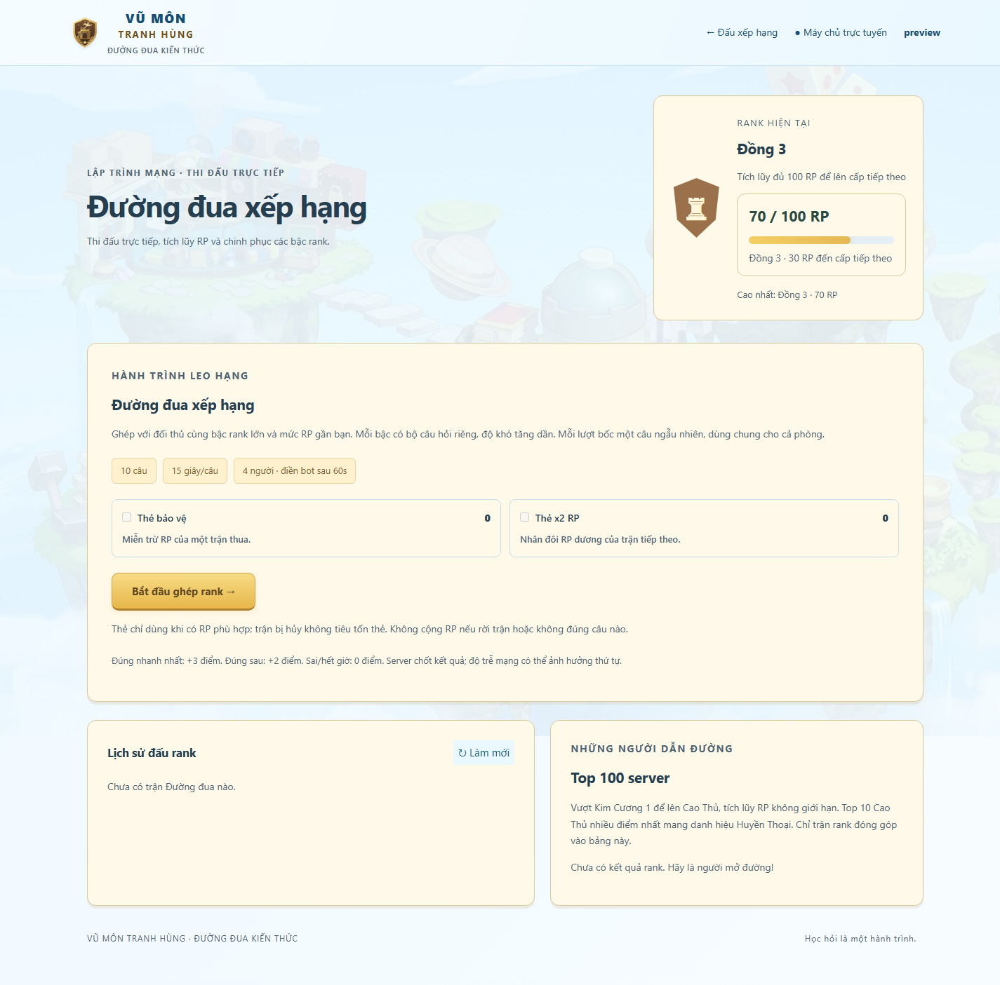

# Vũ Môn Tranh Hùng

**Cổng trò chơi học tập nhiều người chơi thời gian thực — Đồ án Lập trình mạng.**

Backend Java SE tự xử lý TCP Socket, HTTP và WebSocket; trình duyệt là client. Hệ thống gồm phòng ôn luyện, ba trò chơi giải trí, Đường đua Kiến thức với đấu xếp hạng và trang quản trị riêng. Tài khoản, nội dung, lịch sử và điểm rank được lưu trong SQLite.

**Chạy tại máy cá nhân:** [Người chơi](http://localhost:3000/) · [Quản trị](http://localhost:3000/admin). Không có tài khoản/mật khẩu admin mặc định; xem [Database setup](#7-database-setup).



*Ảnh giao diện được chụp từ ứng dụng bằng dữ liệu thử. Tên người chơi và điểm trong ảnh chỉ để minh họa.*

## Mục lục

1. [Project description](#1-project-description)
2. [Architecture](#2-architecture)
3. [Technology stack](#3-technology-stack)
4. [Requirements](#4-requirements)
5. [Installation](#5-installation)
6. [Configuration](#6-configuration)
7. [Database setup](#7-database-setup)
8. [Run server](#8-run-server)
9. [Run client](#9-run-client)
10. [Test](#10-test)
11. [Experimental results](#11-experimental-results)
12. [Novelty](#12-novelty)
13. [Limitations](#13-limitations)
14. [References](#14-references)

## 1. Project description

### Bài toán và mục tiêu

Ứng dụng tạo một không gian vừa ôn tập kiến thức vừa thi đấu cùng người khác. Những vấn đề cần xử lý ở tầng mạng là đồng bộ câu hỏi và thời gian, nhận nhiều đáp án đồng thời, chống gửi lại đáp án, phát hiện mất kết nối và ghi kết quả nhất quán.

Server là nơi quyết định trạng thái trận, hạn trả lời, điểm và phần thưởng. Client hiển thị dữ liệu, gửi thao tác và phản hồi cho người chơi; đồng hồ trên trình duyệt không quyết định đáp án có còn hợp lệ hay không.

### Chức năng

| Phân hệ | Chức năng chính |
| --- | --- |
| Tài khoản | Đăng ký và xác nhận email; đăng nhập mật khẩu hoặc Google; quên/đổi mật khẩu; một phiên người chơi hiện hành cho mỗi tài khoản |
| Phòng ôn luyện | Chọn chủ đề, độ khó; lấy câu hỏi, trả lời và xem lời giải/thống kê trong phiên |
| Đấu trường 100 | Người chơi phụ trả lời trước, sau đó người chơi chính; chọn người chính, loại đối thủ và dùng quyền trợ giúp |
| Chiếc nón kỳ diệu | Tối đa 4 người/phòng; quay điểm, đoán chữ và giải ô chữ theo lượt |
| Đấu trường sinh tử | Trắc nghiệm theo vòng; quản lý HP, loại người chơi và xếp hạng cuối trận |
| Đường đua Kiến thức | Ghép rank; ghép đấu thường; phòng riêng; luyện với bot; thử thách hằng ngày |
| Xếp hạng | Đồng → Bạc → Vàng → Bạch Kim → Kim Cương, mỗi bậc 3 cấp; sau Kim Cương 1 là Cao Thủ tích lũy RP; Top 10 Cao Thủ mang danh hiệu Huyền Thoại |
| Quản trị | Quản lý tài khoản và online/offline; nội dung/CSV/chủ đề; phòng và lịch sử; cấu hình; thông báo; nhật ký; sao lưu |

Chỉ chế độ **RANKED** của Đường đua thay đổi RP. Ba trò chơi giải trí, đấu thường, chơi bot và thử thách ngày không cộng rank. Thử thách ngày có thể thưởng thẻ dùng trong đấu rank.

Rời trận đang chơi có cảnh báo. Bỏ trận đấu thường với người khác làm mất quyền nhận thành tích của người rời; nếu chỉ còn người đó chơi với bot, trận được hủy. Đăng nhập ở thiết bị khác kết thúc phiên cũ và thông báo cho cả hai phía. Chi tiết: [Phiên đăng nhập và rời trận](report/phien-dang-nhap-va-roi-tran.md).

## 2. Architecture

### Kiến trúc tổng thể



Ảnh thể hiện các thành phần của phiên bản đang triển khai. Tải [PNG độ phân giải cao](report/images/architecture.png) để đưa vào báo cáo, hoặc [SVG có thể chỉnh sửa](report/images/architecture.svg). Các luồng phụ được giản lược để sơ đồ dễ đọc.

<details>
<summary>Mã sơ đồ Mermaid</summary>



</details>

Khi chạy trực tiếp, trình duyệt truy cập server trên cổng 3000. Khi công khai qua ngrok/proxy, người dùng truy cập địa chỉ HTTPS của proxy; server Java vẫn nhận HTTP/WebSocket trên cổng nội bộ. **Ứng dụng không tự mở cổng HTTPS riêng.**

### Thành phần mã nguồn

| Thành phần | Trách nhiệm |
| --- | --- |
| [`Main.java`](src/vn/game/Main.java) | Khởi tạo database, game, server; phục hồi trạng thái trận dang dở sau khi bind cổng thành công |
| [`HttpAndWebSocketServer.java`](src/vn/game/server/HttpAndWebSocketServer.java) | Nhận TCP, phân loại HTTP/Upgrade, phục vụ tài nguyên, API, xác thực và định tuyến thông điệp |
| [`WebSocketClient.java`](src/vn/game/server/WebSocketClient.java) | Đọc/ghi frame, khóa ghi, Ping/Pong, đóng kết nối |
| [`SessionManager.java`](src/vn/game/server/SessionManager.java), [`AdminSessions.java`](src/vn/game/server/AdminSessions.java) | Phiên người chơi và phiên quản trị tách biệt, CSRF và kết thúc phiên |
| [`ClientEvents.java`](src/vn/game/server/ClientEvents.java) | Server-Sent Events: thông báo và trạng thái tài khoản ngoài phòng chơi |
| [`games/`](src/vn/game/games) | Quản lý phòng, lượt chơi, thời gian, bot và ghép trận |
| [`db/`](src/vn/game/db) | Schema/migration, truy vấn, giao dịch kết quả, cấu hình, nhật ký và sao lưu |
| [`model/`](src/vn/game/model) | Câu hỏi, ô chữ, luật rank, luyện tập và lịch sử |
| [`public/`](public) | HTML/CSS/JavaScript, hình ảnh và video; được phục vụ bởi chính Java server |

### Giao tiếp và định dạng thông điệp

- **HTTP:** đăng nhập, cấu hình, nội dung, hồ sơ, lịch sử và file tĩnh. Dữ liệu API là JSON UTF-8.
- **WebSocket `/ws`:** thao tác phòng chơi và cập nhật trận; bắt tay/frame dựa trên [RFC 6455](https://www.rfc-editor.org/rfc/rfc6455).
- **SSE `/api/events`:** thông báo server, bảo trì và thay đổi phiên/tài khoản khi người chơi không ở trong game.
- **Cookie:** `session_id` cho người chơi; `admin_session` cho API quản trị. Client phải truy cập cùng origin với server.

Ví dụ client tham gia hàng chờ rank:

```json
{"type":"race_queue","mode":"RANKED","useShield":false,"useDouble":false}
```

Ví dụ gửi đáp án, trong đó `matchId` và `questionToken` phải lấy từ trạng thái server vừa gửi:

```json
{"type":"race_answer","matchId":"<id-tran>","questionToken":"<token-cau-hien-tai>","answer":1}
```

`answer` là chỉ số 0–3 tương ứng A–D. Server trả các gói `race_state` hoặc `race_error`. Với ba trò chơi còn lại, các loại gói có tên riêng như `submit_arena_answer`, `submit_survival_answer`, `wheel_spin`, `wheel_guess`.



### Concurrency và xử lý lỗi

| Cơ chế | Cách triển khai và phạm vi |
| --- | --- |
| Nhiều kết nối | `Executors.newCachedThreadPool()` xử lý kết nối; WebSocket là kết nối dài hạn |
| Trạng thái game | Các thao tác chuyển trạng thái được đồng bộ bằng `synchronized`; scheduler chạy thời gian/phản hồi bot |
| Đường đua | Coordinator chung, tick định kỳ 250 ms; deadline và thứ tự nhận lấy ở server |
| Frame WebSocket | Khóa ghi chung cho text và control frame, tránh Ping/Pong chen giữa một frame JSON |
| Kết quả bền vững | Transaction và khóa duy nhất cho đáp án, ledger RP, lượt/thưởng ngày; gửi lại không tạo thêm phần thưởng |
| SQLite | WAL, foreign keys, `busy_timeout=5000`; lớp admin/rank dùng kết nối giao dịch riêng, không phải một connection pool hoàn chỉnh |
| Mất kết nối | Ping sau khoảng 10 giây không hoạt động, timeout Pong 20 giây; mất mạng im lặng thường cần khoảng 20–30 giây để phát hiện |
| Đầu vào sai | Từ chối request/lệnh sai quyền, trạng thái, token hoặc thời hạn; thông báo lỗi cho client thay vì chấm điểm theo dữ liệu client |

Các mã HTTP thường gặp: `400` dữ liệu sai, `401` chưa có phiên, `403` sai quyền/CSRF, `429` quá số lần thử, `503` dịch vụ chưa sẵn sàng. Khi khởi động lại, trận chưa hoàn thành được xử lý gián đoạn, không tự trao kết quả thắng/RP.

## 3. Technology stack

| Lớp | Công nghệ / dependency |
| --- | --- |
| Backend | Java SE, mã nguồn biên dịch với `--release 17`; `java.net.Socket`, `ServerSocket`, `java.net.http.HttpClient`, `java.util.concurrent` |
| HTTP/WebSocket/JSON | Router HTTP, xử lý frame WebSocket và [`JsonUtil`](src/vn/game/util/JsonUtil.java) do dự án triển khai |
| Client | HTML5, CSS3, JavaScript; Fetch API, WebSocket, EventSource, SVG |
| Database | SQLite qua **Xerial sqlite-jdbc 3.45.3.0** |
| Logging dependency | **slf4j-api 2.0.13**, **slf4j-nop 2.0.13**; JAR nằm trong `lib/` |
| Tài khoản ngoài | Google OAuth 2.0 Authorization Code + PKCE, `state`; SMTP TLS/STARTTLS qua Java |
| Build / QA | `javac`, batch Windows, PowerShell; Node.js và Chrome cho kiểm thử giao diện |
| Công khai server | ngrok hoặc reverse proxy hỗ trợ WebSocket/SSE |

Không cần Maven, Gradle, npm hoặc Node.js để chạy server/client thông thường. Node.js chỉ cần khi chạy các script kiểm thử `.mjs`. Không có backend NodeMailer.

## 4. Requirements

| Điều kiện | Yêu cầu |
| --- | --- |
| Java | **JDK 17 trở lên**, có cả `java` và `javac`; dùng cùng một bản JDK |
| Hệ điều hành | Windows để dùng trực tiếp `.bat` và các script PowerShell; có thể build thủ công trên Linux/macOS |
| Trình duyệt | Bản hiện đại của Chrome/Edge/Firefox có JavaScript, WebSocket và cookie |
| Dependency | Đủ 3 JAR trong [`lib/`](lib) |
| Tệp và cổng | Có quyền ghi `data/`, `bin/`; cổng TCP **3000** chưa bị ứng dụng khác chiếm |
| Email / Google | Internet và cấu hình dịch vụ tương ứng nếu dùng đăng ký email, quên mật khẩu hoặc Google login |
| QA tùy chọn | PowerShell; **Node.js 24.x** và Chrome cho các bài kiểm thử trình duyệt đã cung cấp |

Chưa có cấu hình CPU/RAM tối thiểu được đo riêng. Cấu hình máy dùng cho phép đo tham khảo nằm ở [Experimental results](#11-experimental-results).

## 5. Installation

### 5.1. Chuẩn bị source và Java

Tải/giải nén source hoặc clone repository, sau đó mở terminal tại **thư mục chứa `run.bat`, `src/`, `public/`, `lib/`**. Mọi lệnh bên dưới chạy từ thư mục này, trừ khi được ghi rõ.

```powershell
java -version
javac -version
Get-ChildItem .\lib\*.jar
```

Nếu không tìm thấy `javac`, cài JDK và cấu hình `JAVA_HOME`/`PATH`, rồi mở lại terminal. `run.bat` ưu tiên `JAVA_HOME`, sau đó tìm `javac` trên `PATH` và dùng `java` cùng thư mục để tránh lệch phiên bản.

Ba JAR cần có:

```text
lib/sqlite-jdbc-3.45.3.0.jar
lib/slf4j-api-2.0.13.jar
lib/slf4j-nop-2.0.13.jar
```

Nếu bản source bị thiếu dependency, tải đúng phiên bản:

```powershell
New-Item -ItemType Directory -Force .\lib | Out-Null
Invoke-WebRequest 'https://repo.maven.apache.org/maven2/org/xerial/sqlite-jdbc/3.45.3.0/sqlite-jdbc-3.45.3.0.jar' -OutFile .\lib\sqlite-jdbc-3.45.3.0.jar
Invoke-WebRequest 'https://repo.maven.apache.org/maven2/org/slf4j/slf4j-api/2.0.13/slf4j-api-2.0.13.jar' -OutFile .\lib\slf4j-api-2.0.13.jar
Invoke-WebRequest 'https://repo.maven.apache.org/maven2/org/slf4j/slf4j-nop/2.0.13/slf4j-nop-2.0.13.jar' -OutFile .\lib\slf4j-nop-2.0.13.jar
```

### 5.2. Khởi chạy lần đầu trên Windows

```powershell
# Chỉ tạo .env nếu máy chưa có file cấu hình.
if (-not (Test-Path .env)) { Copy-Item .env.example .env }

# Điền cấu hình tại mục 6, rồi tạo tài khoản admin riêng.
.\setup-admin.bat

# Biên dịch và chạy server; giữ terminal này mở.
.\run.bat
```

Khi tạo admin, công cụ hỏi tên, mật khẩu **12–128 ký tự** và xác nhận mật khẩu. Mật khẩu không hiện khi gõ. Nếu đã có admin trong database đang dùng, đăng nhập bằng tài khoản đó; không cần chạy lại bước tạo.

### 5.3. Cấu trúc thư mục

```text
.
├── README.md
├── .env.example              # Cấu hình mẫu, không chứa thông tin thật
├── run.bat                   # Build và chạy server Windows
├── setup-admin.bat           # Tạo admin tại máy vận hành
├── lib/                      # Dependency JAR
├── src/vn/game/
│   ├── Main.java
│   ├── config/               # Đọc .env
│   ├── server/               # HTTP, WebSocket, SSE, phiên và OAuth
│   ├── games/                # Luật và trạng thái phòng/trận
│   ├── db/                   # SQLite, migration, repository, backup
│   ├── model/                # Nội dung, rank, lịch sử
│   └── util/                 # JSON, CSV, SMTP, xác nhận email
├── public/                   # Toàn bộ client và tài nguyên
├── scratch/                  # Test, benchmark và dữ liệu QA tạm
├── report/                   # Hướng dẫn chuyên sâu, ảnh, kết quả thực nghiệm
├── bin/                      # Sinh sau khi biên dịch; không đưa lên Git
└── data/                     # Sinh khi khởi tạo; không đưa lên Git
    ├── game.db
    └── backups/
```

## 6. Configuration

File [`.env.example`](.env.example) là mẫu đầy đủ các biến ứng dụng đang đọc. Tạo `.env` ở thư mục gốc và điền giá trị cần dùng; không đưa `.env` lên Git hoặc vào gói source công khai.

| Biến | Giá trị mặc định / ý nghĩa |
| --- | --- |
| `APP_BASE_URL` | `http://localhost:3000`; origin để tạo liên kết email, OAuth và xác định cookie HTTPS |
| `GOOGLE_CLIENT_ID` | Client ID của OAuth client loại Web application; để trống nếu chưa dùng Google login |
| `GOOGLE_CLIENT_SECRET` | Client secret tương ứng, chỉ lưu ở server |
| `GOOGLE_REDIRECT_URI` | Để trống: lấy `APP_BASE_URL` + `/auth/google/callback` |
| `GMAIL_USER` | Email hệ thống dùng để gửi thư |
| `GMAIL_APP_PASSWORD` | Mật khẩu ứng dụng của hộp thư gửi |
| `SMTP_HOST` | `smtp.gmail.com` |
| `SMTP_PORT` | `465`; có thể chọn `587` với STARTTLS |
| `SMTP_SECURITY` | `auto`: TLS trực tiếp ở 465, STARTTLS ở 587; hỗ trợ `ssl`/`starttls` |
| `ADMIN_BOOTSTRAP_USERNAME` | Tùy chọn tạo admin đầu tiên khi khởi động |
| `ADMIN_BOOTSTRAP_PASSWORD` | Mật khẩu bootstrap 12–128 ký tự; bỏ giá trị sau khi đã tạo tài khoản |

`.env` có giá trị không rỗng được ưu tiên; nếu thiếu/rỗng, [`Env`](src/vn/game/config/Env.java) đọc biến môi trường của tiến trình. Viết `KEY=value`; không thêm dấu `=` vào đầu giá trị. Không dùng `SESSION_SECRET`: bản hiện tại không đọc biến này.

**Cổng và đường dẫn database hiện chưa cấu hình bằng `.env`:** `Main.java` dùng cổng 3000; database là `data/game.db` tính từ thư mục làm việc.

### 6.1. Email đăng ký và quên mật khẩu

```dotenv
APP_BASE_URL=http://localhost:3000
GMAIL_USER=your-sender@gmail.com
GMAIL_APP_PASSWORD=your-app-password
SMTP_HOST=smtp.gmail.com
SMTP_PORT=465
SMTP_SECURITY=auto
```

Đây là thông tin mẫu, phải thay bằng tài khoản gửi thư của người vận hành. Nếu dùng Gmail, tạo App Password theo [hướng dẫn của Google](https://support.google.com/accounts/answer/185833); tài khoản cần bật xác minh hai bước và có thể chịu giới hạn của tổ chức.

Đăng ký mới gửi liên kết xác nhận có hạn **30 phút**. Quên mật khẩu gửi mã **6 số**, hạn **10 phút**, tối đa **5 lần nhập sai**, chờ **60 giây** trước khi gửi lại. Kiểm tra hộp thư rác nếu không thấy thư.

Không cấu hình SMTP vẫn có thể mở server/admin và đăng nhập tài khoản đã tồn tại. Tạo tài khoản người chơi mới qua email và khôi phục mật khẩu cần SMTP hoạt động; Google login là luồng riêng. Cấu hình gửi thư được đọc lại khi sử dụng, không cần sửa mã Java.

### 6.2. Google login

1. Tạo OAuth client loại **Web application** và cấu hình màn hình đồng ý trong Google Cloud theo [tài liệu OAuth của Google](https://developers.google.com/identity/protocols/oauth2/web-server).
2. Điền `GOOGLE_CLIENT_ID`, `GOOGLE_CLIENT_SECRET` vào `.env`.
3. Thêm đúng callback vào **Authorized redirect URIs**:

   ```text
   http://localhost:3000/auth/google/callback
   ```

4. Với domain HTTPS/ngrok, thay cả `APP_BASE_URL` và URI đã đăng ký. Nếu đặt `GOOGLE_REDIRECT_URI`, giá trị đó phải trùng URI tại Google, gồm scheme, host, cổng và path.
5. Nếu ứng dụng Google còn ở chế độ thử nghiệm, thêm tài khoản thử theo cấu hình của dự án Google Cloud.

Server sử dụng Authorization Code, PKCE S256, `state` và cookie ràng buộc luồng đăng nhập; token của provider không gửi xuống client. Callback chỉ chấp nhận HTTPS hoặc HTTP của localhost. Không dùng `http://192.168.x.x:3000/auth/google/callback` cho Google login; sử dụng domain HTTPS khi truy cập từ thiết bị khác.

### 6.3. Cấu hình gameplay

Đăng nhập `/admin`, dùng **Đường đua & Rank** và **Cấu hình & bảo trì**. Thiết lập được lưu trong SQLite, không phải `.env`. Mặc định Đường đua: 10 câu, 15 giây/câu; điền bot sau 60 giây; thử thách ngày 7 giây/câu. Thay đổi chỉ áp dụng cho lượt/trận mới theo phạm vi cấu hình.

## 7. Database setup

### 7.1. Khởi tạo và dữ liệu mẫu

Không cần cài MySQL/PostgreSQL hoặc chạy file SQL thủ công. Lần đầu chạy `setup-admin.bat` hoặc server, [`DatabaseManager`](src/vn/game/db/DatabaseManager.java) tạo `data/game.db`, schema và migration cần thiết.

Dữ liệu câu hỏi/chủ đề/ô chữ trong Java được đưa vào SQLite theo cơ chế seed một lần. Đường đua có nội dung mạng dùng chung và bộ câu hỏi riêng theo bậc rank; bộ rank khởi tạo **75 câu, 15 câu mỗi bậc lớn**. Sau khởi tạo, admin sửa nội dung trong database; restart không tự ghi đè lại nội dung đã sửa. Cao Thủ dùng bộ câu hỏi Kim Cương.

| Nhóm bảng | Dữ liệu |
| --- | --- |
| `users`, `pending_registrations` | Tài khoản và đăng ký chờ xác nhận |
| `education_topics`, `game_questions`, `wheel_phrases`, `content_revisions` | Chủ đề, câu hỏi/ô chữ và phiên bản nội dung |
| `matches`, `match_players`, `leaderboard` | Lịch sử/thành tích của ba game; bảng legacy không được quy đổi sang RP |
| `player_ranks`, `race_matches`, `race_players` | Rank và trận Đường đua |
| `race_rounds`, `race_answers`, `race_participation` | Câu đã mở, đáp án, deadline, thành viên trận |
| `rank_ledger`, `player_cards`, `daily_attempts` | Giao dịch RP, thẻ và lượt thử thách ngày |
| `app_settings`, `admin_audit_logs` | Cấu hình và nhật ký thao tác |

Schema thực tế nằm trong [`db/`](src/vn/game/db) và [`MatchService.java`](src/vn/game/model/MatchService.java). Một số trường được thêm bằng migration để giữ dữ liệu cũ.

### 7.2. Tài khoản quản trị

Không có cơ chế đăng ký admin công khai và không cấp quyền admin chỉ vì tên tài khoản là `admin`.

- Tạo tương tác: `setup-admin.bat`.
- Tạo lúc khởi động: điền **cả hai** biến `ADMIN_BOOTSTRAP_USERNAME` và `ADMIN_BOOTSTRAP_PASSWORD`; chỉ có hiệu lực khi chưa có admin.
- Khôi phục mật khẩu tại terminal tương tác, sau khi đã build:

  ```powershell
  java -cp 'bin;lib/*' vn.game.db.AdminAccount --reset 'ten-admin-cua-ban'
  ```

Tài khoản quản trị đăng nhập tại `/admin`. Dùng tài khoản người chơi khác để tham gia game.

### 7.3. Giữ dữ liệu khi pull code hoặc triển khai

**GitHub đồng bộ mã nguồn, không đồng bộ database đang chạy.** `.gitignore` loại `data/`, `.env` và file database khỏi source.

- `git pull`/thay mã nguồn trên máy server không yêu cầu xóa database. Giữ nguyên `data/` và `.env`, build lại rồi chạy từ cùng thư mục.
- Người khác clone và chạy trên máy của họ sẽ có database riêng. Muốn cùng tài khoản/điểm/nội dung, mọi người truy cập **cùng địa chỉ server**.
- Khi chuyển máy hoặc dùng môi trường triển khai, lưu `data/` trên ổ/volume bền vững. Chép database hoặc bản sao lưu qua kênh riêng khi cần chuyển dữ liệu.
- **Giữ dữ liệu không đồng nghĩa giữ trận đang diễn ra:** restart kết thúc các kết nối/phiên trong bộ nhớ; trận chưa hoàn thành được ghi gián đoạn và cần tạo trận mới.

### 7.4. Sao lưu và phục hồi

Trong admin → **Sao lưu dữ liệu** → **Tạo bản sao lưu** → tải file `.db`. Server dùng [`VACUUM INTO`](https://www.sqlite.org/lang_vacuum.html) để lấy ảnh chụp nhất quán, kể cả dữ liệu đã commit trong WAL. Không chép riêng `game.db` khi server vẫn đang ghi; SQLite có thể còn dữ liệu trong file WAL. Tham khảo [SQLite WAL](https://www.sqlite.org/wal.html).

Ví dụ tạo bản A khi rank có 10 câu, sau đó đổi server thành 15 câu: bản A vẫn giữ 10. Cột “Máy chủ hiện tại” chỉ để đối chiếu. **Áp dụng cấu hình** chỉ áp dụng các nhóm thiết lập, không khôi phục đè tài khoản/câu hỏi/lịch sử.

Để phục hồi **toàn bộ database**: dừng server; lưu riêng toàn bộ thư mục `data/` hiện tại; dùng bản sao lưu nhất quán làm `data/game.db` trong thư mục dữ liệu mới; không ghép các file `-wal`/`-shm` cũ với database được phục hồi; chạy lại server từ thư mục dự án. Không có form upload database trong admin.

Chi tiết: [Sao lưu cấu hình cố định](report/sao-luu-cau-hinh-co-dinh.md), [Quản trị server](report/quan-tri-server.md).

## 8. Run server

### 8.1. Windows — cách chính

```powershell
.\run.bat
```

Script biên dịch Java, tạo thư mục cần thiết và mở server ở `http://localhost:3000`. Giữ terminal hoạt động; dùng `Ctrl+C` khi muốn dừng.

**Build/chạy thủ công trong PowerShell** nếu cần xem lỗi rõ hơn:

```powershell
New-Item -ItemType Directory -Force .\bin | Out-Null
$javaSources = (Get-ChildItem .\src -Recurse -Filter *.java).FullName
javac --release 17 -encoding UTF-8 -cp 'lib/*' -d bin $javaSources
if ($LASTEXITCODE -ne 0) { throw 'Build failed' }
java -Dfile.encoding=UTF-8 -cp 'bin;lib/*' vn.game.Main
```

Trên JDK mới, SQLite có thể phát cảnh báo native access; khi đó có thể thêm `--enable-native-access=ALL-UNNAMED` vào lệnh `java`. Không đổi target `--release 17` chỉ để xử lý cảnh báo.

### 8.2. Linux/macOS — build thủ công

Các lệnh dưới dùng shell POSIX; script `.bat`/PowerShell QA không được dùng trực tiếp trong môi trường này. Bản thực nghiệm của README được chạy trên Windows.

```sh
mkdir -p bin
find src -name '*.java' -print > bin/sources.list
javac --release 17 -encoding UTF-8 -cp 'lib/*' -d bin @bin/sources.list
java -Dfile.encoding=UTF-8 -cp 'bin:lib/*' vn.game.Main
```

Windows dùng dấu `;` trong classpath; Linux/macOS dùng dấu `:`.

### 8.3. LAN

Server bind `0.0.0.0:3000`. Mở `http://<IP-LAN-cua-server>:3000/` từ thiết bị cùng mạng. Xem IP được in trong terminal hoặc dùng `ipconfig` trên Windows.

Nếu firewall chặn, chạy `open_firewall.bat` với quyền Administrator hoặc cho phép TCP 3000 trong firewall. Giao thức của ứng dụng dùng **TCP**; không cần UDP để chơi. `run.bat` hiện có thêm bước tạo rule firewall nếu được chạy với quyền Administrator; chạy thông thường không đòi quyền này.

Khi gửi email liên kết cho thiết bị khác, đổi `APP_BASE_URL` sang địa chỉ thiết bị đó truy cập được. Với Google login, dùng HTTPS thay vì callback LAN HTTP.

### 8.4. Công khai qua ngrok

Sau khi server local chạy tốt, cài và cấu hình ngrok theo [hướng dẫn chính thức](https://ngrok.com/docs/start):

```powershell
ngrok config add-authtoken 'YOUR_NGROK_AUTHTOKEN'
ngrok http 3000
```

Thay chuỗi token mẫu bằng token của bạn. Lấy URL HTTPS do ngrok cấp, đặt vào `APP_BASE_URL` và cập nhật URI Google thành `<URL-HTTPS>/auth/google/callback`. Sau khi đổi origin triển khai, khởi động lại Java vào thời điểm phù hợp để toàn bộ cấu hình cookie dùng giá trị mới, rồi đăng nhập tại URL đó. Nếu domain thay đổi, cập nhật cả hai nơi. Dùng một URL nhất quán trong mỗi phiên; cookie `Secure` của cấu hình HTTPS không được gửi qua HTTP local.

Giữ cả tiến trình Java và ngrok chạy. Tunnel chỉ chuyển tiếp kết nối; nó không tự lưu database hoặc giữ server hoạt động sau khi tắt máy.

### 8.5. Lỗi thường gặp

| Hiện tượng | Kiểm tra / cách xử lý |
| --- | --- |
| Không tìm thấy `javac` | Cài JDK, sửa `JAVA_HOME`/`PATH`, mở terminal mới |
| `UnsupportedClassVersionError` | Dùng cùng JDK cho `java` và `javac`; build lại với `--release 17` |
| `org.sqlite.JDBC` / thiếu SLF4J | Kiểm tra đủ 3 JAR và classpath `bin;lib/*` |
| `Address already in use` | Cổng 3000 đang có tiến trình; không chạy thêm server dùng cùng `data/` |
| Mất dữ liệu hoặc thấy database mới | Kiểm tra thư mục làm việc; `data/game.db` là đường dẫn tương đối |
| HTTP local không giữ đăng nhập | Kiểm tra `APP_BASE_URL` đang là HTTPS; dùng đúng URL công khai hoặc cấu hình local và đăng nhập lại |
| `redirect_uri_mismatch` / Google không vào được | So khớp URL callback chính xác, thông tin client và danh sách tài khoản thử |
| Không nhận email | Kiểm tra SMTP/App Password, kết nối ra ngoài và thư rác; xem mục Google & Email trong admin |
| Game không cập nhật qua proxy | Proxy phải chuyển WebSocket Upgrade và giữ SSE; kiểm tra `/ws`, `/api/events` trong DevTools |
| Giao diện còn bản cũ | Nhấn `Ctrl+F5` sau khi thay tài nguyên frontend |

## 9. Run client

Không có bước build client riêng. Sau khi Java server chạy, mở trình duyệt:

| Trang | Đường dẫn |
| --- | --- |
| Trang chủ / đăng nhập người chơi | `http://localhost:3000/` |
| Admin | `http://localhost:3000/admin` |
| Đấu rank | `http://localhost:3000/race.html?mode=ranked` |
| Đường đua đấu thường | `http://localhost:3000/race.html?mode=casual` |
| Luyện với máy | `http://localhost:3000/race.html?mode=bot` |
| Thử thách ngày | `http://localhost:3000/race.html?mode=daily` |
| Ba game giải trí | `/arena.html`, `/wheel.html`, `/survival.html` trên cùng server |

Không mở `public/index.html` bằng `file://` hoặc chạy frontend trên cổng khác bằng Live Server; cookie và API của ứng dụng dùng cùng origin.

**Luồng dùng thử:** đăng ký và xác nhận email, hoặc đăng nhập Google đã cấu hình → chọn đảo trên trang chủ → vào phòng ôn luyện hoặc một chế độ chơi → tạo/ghép/tham gia phòng → sẵn sàng/bắt đầu → xem điểm và kết quả. Để kiểm tra hai người chơi trên một máy, dùng hai tài khoản khác nhau trong hai hồ sơ trình duyệt hoặc cửa sổ thường/ẩn danh. Hai lần đăng nhập cùng tài khoản sẽ thay thế phiên cũ.

Phòng ôn luyện và bảng xếp hạng mở từ trang chủ. Admin dùng form đăng nhập riêng và không cần mở một client chơi game để quản lý server.

<details>
<summary>Ảnh trang đăng nhập admin và đấu rank</summary>





*Ảnh có dữ liệu mô phỏng, không phải số liệu đo hiệu năng.*

</details>

## 10. Test

### 10.1. Kiểm tra thủ công sau cài đặt

1. Mở `/` và `/admin`; tài nguyên tải thành công.
2. Đăng nhập admin vừa tạo; xem ngân hàng câu hỏi và cấu hình.
3. Tạo hai tài khoản người chơi, mở hai phiên trình duyệt độc lập và vào cùng phòng.
4. Trả lời câu hỏi/quay nón; kiểm tra hai client nhận cập nhật.
5. Thử rời trận, đóng một kết nối hoặc đăng nhập lại cùng tài khoản; xem thông báo và trạng thái online/offline.
6. Tạo bản sao lưu ở 10 câu, đổi cấu hình thành 15 câu và xem lại bản cũ; giá trị cố định vẫn là 10.

### 10.2. Kiểm thử tích hợp bằng Java/PowerShell

Chạy từ thư mục gốc, với `javac` và `java` cùng JDK. Các bộ dưới tạo **database/thư mục thử riêng trong `scratch/`**; bộ có server mạng sử dụng cổng riêng.

```powershell
powershell -NoProfile -ExecutionPolicy Bypass -File scratch/test_rank_backup.ps1
powershell -NoProfile -ExecutionPolicy Bypass -File scratch/test_player_lifecycle.ps1
powershell -NoProfile -ExecutionPolicy Bypass -File scratch/test_connection_notices.ps1
```

| Script | Phạm vi |
| --- | --- |
| `test_rank_backup.ps1` | Cao Thủ/Huyền Thoại, RP lớn, migration cũ, sao lưu bất biến, áp dụng cấu hình |
| `test_player_lifecycle.ps1` | Online/offline, đăng nhập đồng thời, thay phiên, rời trận, loại kết quả và hủy khi chơi bot |
| `test_connection_notices.ps1` | WebSocket thật, Ping/Pong, ngắt kết nối và thông báo trong cả ba game |
| `test_race.ps1` | Ghép trận/rank/daily, RP/thẻ, kết nối lại, anti-replay và quyền quản trị |
| `test_admin.ps1`, `test_admin_ranking.ps1` | Quản trị, quyền, lọc và phân trang bảng rank |
| `test_arena_rules.ps1`, `test_survival_rules.ps1` | Luật và thời gian của từng game |

Hai bộ luật game và bộ thông báo kết nối dùng thêm class trong `bin/`; build trước bằng lệnh ở mục 8 nếu chưa có. Các file `.ps1`/Java phụ trợ cần được giữ trong gói source để người nhận chạy test được.

### 10.3. Kiểm thử frontend

Các test UI dưới dùng môi trường JavaScript mô phỏng, không cần gửi thư:

```powershell
node scratch/test_admin_drafts_ui.mjs
node scratch/test_arena_ui.mjs
node scratch/test_survival_ui.mjs
node scratch/test_wheel_presence_ui.mjs
node scratch/test_rank_progress.mjs
node scratch/test_match_leave_guard.mjs
```

Với Chrome đã cài ở đường dẫn mặc định trên Windows và server local đang phục vụ cổng 3000:

```powershell
node scratch/test_vm_theme_browser.mjs
node scratch/test_rank_backup_browser.mjs
```

Hai test trình duyệt dùng API/WebSocket mô phỏng, kiểm tra desktop/mobile, cỡ chữ, các trạng thái đáp án/HP, form admin và màu gốc của trang chủ/ôn luyện/bảng xếp hạng. Chúng không ghi database thật. Ảnh và kết quả rà tương phản nằm trong thư mục `scratch/*browser-*`. Nếu Chrome ở đường dẫn khác, sửa đường dẫn executable ở đầu script.

### 10.4. Đo mạng có thể tái lập

```powershell
powershell -NoProfile -ExecutionPolicy Bypass -File scratch/benchmark_network.ps1
```

Script biên dịch mã hiện tại, tạo database mới, mở server trên cổng ngẫu nhiên và đo HTTP/WebSocket thật. Kết quả mặc định lưu tại `scratch/network-results-<thoi-gian>/`. Có thể chỉ định thư mục khác bằng `-OutputDirectory`.

Không chạy các bài kiểm thử/benchmark thủ công từ thư mục `data/` hoặc sao chép dữ liệu thật vào môi trường thử. Mỗi script có marker nhận diện thư mục cô lập.

## 11. Experimental results

### 11.1. Thiết lập thực nghiệm

Kết quả dưới được ghi nhận **01/11/2026**, không suy từ số ô/nhân vật trên giao diện.

| Điều kiện | Giá trị |
| --- | --- |
| Hệ điều hành | Windows 11, amd64; bản hệ thống 10.0.26200 |
| Java | Azul OpenJDK **24.0.1**, biên dịch source với `--release 17` |
| CPU | JVM nhận **16 bộ xử lý logic** |
| Dependency | SQLite JDBC 3.45.3.0, SLF4J 2.0.13 |
| Mạng đo | Loopback `127.0.0.1`, client và server cùng máy; không ngrok/TLS |
| Dữ liệu | Database SQLite mới với dữ liệu mẫu tự khởi tạo và 32 tài khoản thử |
| Tải | 1, 4, 16, 32 worker/client đồng thời; 30 lượt/client/mức |
| Warm-up | 2 lượt/client/mức/giao thức, không tính vào mẫu đo |

Đo thời gian bằng `System.nanoTime()` từ trước gửi yêu cầu đến khi nhận/kiểm tra phản hồi. HTTP gọi **`GET /auth/me` đã có phiên**; WebSocket giữ kết nối và gửi **`get_rooms`**, đợi **`room_list`**. Mỗi client chờ phản hồi trước khi gửi lượt tiếp. Không đo thời gian người dùng đăng nhập hoặc thời gian hoàn thành một trận.

### 11.2. Kiểm thử tính đúng đắn

| Bộ kiểm thử đã chạy | Kiểm tra đạt | Bằng chứng |
| --- | ---: | --- |
| Rank / backup | 55 | [Log](report/experiments/test_rank_backup.log) |
| Vòng đời người chơi / phiên | 141 | [Log](report/experiments/test_player_lifecycle.log) |
| WebSocket / heartbeat / disconnect | 36 | [Log](report/experiments/test_connection_notices.log) |
| **Tổng ba bộ trên** | **232** | Không cộng các bộ chưa chạy vào tổng này |

Đây là số assertion của test, không phải số người chơi đồng thời được bảo đảm hỗ trợ.

### 11.3. Độ trễ và thông lượng

Tổng cộng **3.180 mẫu đo**, không có lỗi phản hồi trong lần chạy được lưu. P95 là giá trị ở phân vị 95 theo phương pháp nearest-rank. Throughput = số lượt thành công / thời gian cả batch.

| Giao thức / thao tác | Client đồng thời | Mẫu | Trung bình (ms) | P95 (ms) | Lượt thành công/s | Lỗi |
| --- | ---: | ---: | ---: | ---: | ---: | ---: |
| HTTP `/auth/me` | 1 | 30 | 14.67 | 17.42 | 68.10 | 0 |
| HTTP `/auth/me` | 4 | 120 | 15.96 | 20.41 | 248.15 | 0 |
| HTTP `/auth/me` | 16 | 480 | 50.52 | 90.82 | 301.71 | 0 |
| HTTP `/auth/me` | 32 | 960 | 106.70 | 214.52 | 276.37 | 0 |
| WebSocket `get_rooms` | 1 | 30 | 7.52 | 9.24 | 132.44 | 0 |
| WebSocket `get_rooms` | 4 | 120 | 31.59 | 61.81 | 106.45 | 0 |
| WebSocket `get_rooms` | 16 | 480 | 117.16 | 273.26 | 123.41 | 0 |
| WebSocket `get_rooms` | 32 | 960 | 217.07 | 485.71 | 141.00 | 0 |

Bằng chứng và mã tái lập:

- [Metadata và số liệu tổng hợp JSON](report/experiments/network-benchmark.json).
- [Toàn bộ 3.180 mẫu CSV](report/experiments/network-samples.csv).
- [Mã đo Java](scratch/NetworkBenchmark.java), [script chạy](scratch/benchmark_network.ps1).

### 11.4. Phân tích và giới hạn phép đo

Trong lần chạy này, thông lượng HTTP tăng đến mức 16 client rồi giảm ở mức 32, trong khi P95 tăng. Độ trễ WebSocket cũng tăng theo số client. Kết quả cho thấy ứng dụng xử lý được các yêu cầu đo ở các mức tải này, đồng thời cần tối ưu khi tải tăng; không thể xem 32 là giới hạn tối đa hoặc cam kết số người chơi thực tế.

Hai thao tác đo có đường xử lý/payload khác nhau, nên bảng không chứng minh giao thức này luôn nhanh hơn giao thức kia. Khóa chung khi định tuyến WebSocket và truy vấn SQLite có thể góp phần vào độ trễ; đây là nhận định từ mã nguồn, chưa phải kết luận từ profiler.

Phép đo chỉ là một lần chạy trên máy phát triển, thời gian ngắn, database nhỏ và mạng loopback. Chưa đo WAN/ngrok, độ trễ đồng bộ giữa nhiều máy, nhiều trận đầy đủ, tải hàng trăm người hay độ ổn định dài hạn. Muốn đánh giá triển khai thực tế cần chạy lặp trên máy riêng và bổ sung các kịch bản đó.

## 12. Novelty

Các đóng góp dưới đây nằm trong phạm vi đồ án, so với mô hình quiz cơ bản chỉ gửi câu hỏi và lưu điểm cuối trận; không khẳng định là thuật toán mới trên thế giới. Thay đổi màu sắc, logo và animation không được tính là novelty kỹ thuật.

| Đóng góp | Khác biệt kỹ thuật | Bằng chứng |
| --- | --- | --- |
| Chấm thi do server quyết định | Kiểm tra lượt, deadline, token câu hỏi và thứ tự nhận; loại yêu cầu trùng/sai trận trước khi ghi điểm | [`KnowledgeRaceGame`](src/vn/game/games/KnowledgeRaceGame.java), [`RaceStore`](src/vn/game/db/RaceStore.java), `test_race.ps1` |
| Kết quả và RP có tính idempotent | Transaction và khóa duy nhất ngăn chốt lại trận, cộng lại RP, dùng/thưởng thẻ nhiều lần | [`RaceStore`](src/vn/game/db/RaceStore.java), 55 kiểm tra rank/backup |
| Phiên đăng nhập gắn với vòng đời trận | Phiên mới thay phiên cũ; trạng thái online/offline phân biệt quyền đăng nhập; bỏ cuộc loại kết quả, bot được xử lý riêng | [`SessionManager`](src/vn/game/server/SessionManager.java), 141 kiểm tra lifecycle |
| Nội dung và cấu hình có bản chụp | Nội dung đã dùng trong trận và cấu hình bản sao lưu giữ được giá trị lịch sử khi admin sửa dữ liệu hiện tại | [`MatchService`](src/vn/game/model/MatchService.java), [`AdminStore`](src/vn/game/db/AdminStore.java), 55 kiểm tra rank/backup |
| Phân bậc câu hỏi và ghép trận | Bộ câu hỏi riêng theo bậc, tỷ lệ độ khó theo rank, hàng chờ rank/thường tách biệt, bot bù chỗ, rank Cao Thủ/Huyền Thoại | [`RankedQuestionBank`](src/vn/game/model/RankedQuestionBank.java), [`RankRules`](src/vn/game/model/RankRules.java), [`KnowledgeRaceGame`](src/vn/game/games/KnowledgeRaceGame.java) |

Bảng benchmark ở mục 11 là số đo của triển khai hiện tại; chưa có phép đo đối chứng với một triển khai baseline độc lập nên không dùng để tuyên bố mức cải thiện phần trăm.

## 13. Limitations

- **Một tiến trình:** hàng chờ, phòng và phiên nằm trong bộ nhớ; chưa chia sẻ trạng thái qua nhiều server hoặc cân bằng tải gameplay.
- **Restart:** dữ liệu đã commit được giữ nhưng phiên/kết nối mất; trận dang dở không tự phục hồi để chơi tiếp sau restart. Trong cùng tiến trình, khả năng nối lại tùy chế độ/trạng thái.
- **Concurrency:** cached thread pool chưa có giới hạn tải tổng thể rõ ràng; một số khóa/coordinator và truy vấn SQLite có thể trở thành điểm nghẽn. SQLite WAL không có nghĩa là nhiều writer ghi đồng thời.
- **Phạm vi giao thức:** có triển khai HTTP/WebSocket riêng phục vụ ứng dụng, chưa được chứng nhận tương thích toàn diện hoặc thay thế một web server đã được harden.
- **Mật khẩu:** admin và một số luồng dùng PBKDF2-HMAC-SHA256, 600.000 vòng; vẫn còn luồng người chơi/dữ liệu cũ dùng SHA-256 + salt. Cơ chế băm chưa được thống nhất cho toàn bộ vòng đời mật khẩu.
- **Triển khai:** chưa có HTTPS trực tiếp, container/CI/CD hay migration tool riêng. Cổng và đường dẫn DB còn cố định trong mã; cần proxy/ngrok nếu công khai HTTPS.
- **Dịch vụ ngoài:** đăng ký email/khôi phục mật khẩu phụ thuộc SMTP; Google login phụ thuộc cấu hình, quyền và kết nối provider. Kiểm thử mô phỏng không thay cho kiểm thử với tài khoản dịch vụ thật.
- **Gameplay:** chưa có mùa giải/reset mùa, anti-cheat hành vi nâng cao, giám sát thi hoặc voice/video. Mạng chậm có thể ảnh hưởng thứ tự server nhận đáp án.
- **Đánh giá:** mới có đo tải ngắn trên loopback; chưa có kết luận khả năng phục vụ hàng trăm người hoặc độ sẵn sàng sản xuất.
- **Tài nguyên:** cần giữ đủ hình ảnh/video trong `public/assets/`. Nguồn và quyền sử dụng tài nguyên bên ngoài phải được nhóm kiểm tra khi phát hành/nộp bài; repository hiện chưa có manifest nguồn cho từng asset hoặc giấy phép tổng thể được xác nhận.

Hướng phát triển: thống nhất password hashing, giới hạn tải/backpressure, profiling và connection pool, test WAN/soak test, tách cấu hình triển khai, chuẩn hóa migration và bổ sung CI trước khi mở rộng nhiều tiến trình.

## 14. References

### Tài liệu nền tảng và dependency

1. Oracle. [Java SE 17 — `ServerSocket`](https://docs.oracle.com/en/java/javase/17/docs/api/java.base/java/net/ServerSocket.html). Tham chiếu mô hình nhận kết nối TCP.
2. IETF. [RFC 6455 — The WebSocket Protocol](https://www.rfc-editor.org/rfc/rfc6455). Tham chiếu handshake, frame và control frame.
3. SQLite. [Write-Ahead Logging](https://www.sqlite.org/wal.html). Cơ chế WAL và giới hạn concurrency của database.
4. SQLite. [VACUUM / VACUUM INTO](https://www.sqlite.org/lang_vacuum.html). Tạo bản sao nhất quán.
5. Xerial. [SQLite JDBC](https://github.com/xerial/sqlite-jdbc). Driver JDBC được dùng; phiên bản đi kèm dự án là 3.45.3.0.
6. SLF4J. [Manual](https://www.slf4j.org/manual.html). Dependency logging API và binding NOP đi kèm driver.
7. Google. [OAuth 2.0 for Web Server Applications](https://developers.google.com/identity/protocols/oauth2/web-server). Thiết lập OAuth client và callback.
8. Google Account Help. [Sign in with app passwords](https://support.google.com/accounts/answer/185833). Cấu hình hộp thư gửi của hệ thống.
9. ngrok. [Get Started](https://ngrok.com/docs/start). Chuyển tiếp server local ra URL công khai.

### Tài liệu chi tiết trong dự án

- [Đường đua xếp hạng: luật, dữ liệu và quản trị](report/duong-dua-xep-hang.md).
- [Quản trị, nội dung CSV và vận hành server](report/quan-tri-server.md).
- [Tài khoản, OAuth, email và thông báo](report/tai-khoan-va-thong-bao.md).
- [Phiên đăng nhập và rời trận](report/phien-dang-nhap-va-roi-tran.md).
- [Sao lưu cấu hình cố định](report/sao-luu-cau-hinh-co-dinh.md).
- [Giao diện và cách kiểm tra](report/giao-dien-vu-mon-tranh-hung.md).

README mô tả phiên bản source hiện tại. Các báo cáo cập nhật cũ có thể ghi số kiểm thử/cấu hình tại thời điểm trước; khi cần xác minh, đối chiếu mã nguồn, file kết quả và chạy lại lệnh tương ứng trong README.
